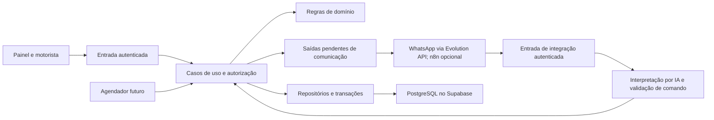

# Arquitetura do backend — proposta

[Início](../README.md) · [Arquitetura](arquitetura.md) · [Dados](modelo-dados.md) · [API](api.md) · [Backlog](backlog.md) · [Regras](requisitos.md)

Desenho iniciado em 14/10/2026 e consolidado em 22/10/2026, com B02–B08 implementadas localmente conforme o [backlog](backlog.md); demais módulos ainda propostos. As regras confirmadas estão em [requisitos](requisitos.md) e [decisões](decisoes.md). Organização em módulos, contratos e mecanismos abaixo são propostas técnicas revisáveis, com TypeORM/migrações e Supabase Auth confirmados; versões do backend verificadas em [B02](../specs/001-base-backend/research.md); hospedagem pendente.

## Estrutura proposta

O projeto local PRM 2026, ainda incompleto, é referência autorizada para organização modular e separação entre frontend e backend. Evidências e limites estão no [registro da referência](decisoes.md#referência-técnica--prm-2026). TypeORM foi confirmado separadamente por Taís. Axios, React Query, versões e configurações do PRM não são automaticamente decisões do TechBus.

Stack escolhida em 20/10/2026, com decisões adicionais consolidadas em 22/10/2026; a organização interna continua proposta. Supabase para dados e Supabase Auth para identidade foram confirmados separadamente. Vite no frontend e Nest CLI no backend. B00 concluída quanto à seleção; escolhas mínimas de B01 concluídas e preparação técnica executada em B02.

Backend modular em NestJS e frontend em React com Vite, Tailwind CSS e shadcn/ui, conforme escolhas de 20/10/2026. Sem microserviços nesta proposta; regras ficam no servidor. A entrada HTTP valida identidade e dados, chama casos de uso e retorna resultados. Casos de uso consultam regras de domínio e persistência por interfaces. Nenhuma regra depende de texto livre ou decisão autônoma da IA.

Diagrama lógico, sem conexão instalada. IA recebe contexto mínimo e devolve intenção estruturada; não recebe acesso irrestrito ao banco, não define perfil e não escolhe aluno por ID livre. Backend resolve o aluno pelo telefone autenticado no evento e reaplica vigência, calendário, prazo, locais e permissões. Saída ambígua pede esclarecimento; persistindo, pendência à equipe. Nunca confirmar somente porque o modelo sugeriu.

| Módulo | Responsabilidade e referência |
| --- | --- |
| Identidade e acesso | Perfis, convites exclusivos do admin e leitura do motorista restrita às atribuições (R20). Identidade técnica separada da pessoa motorista. |
| Cadastros e elegibilidade | Alunos, vigências sem financeiro, universidade, dias habituais e calendários/exceções; telefone conhecido e dia extra (R01–R03). |
| Jornada diária | Estado por sentido, comandos explícitos, limites 17h/22h, fechamento padrão e correção da equipe (R05–R11). |
| Locais | Área/grupo, pontos de ida, endereço de volta, padrão/consentimento e sequência de quatro usos confirmados (R12–R13). |
| Operação e frota | Etapas, grupos manuais, assentos, disponibilidade, recomendação apenas intermunicipal e confirmação do planejamento (R14–R18). |
| Comunicação | Consulta/lembretes, resumo, falhas e reenvio sem alterar respostas (R04, R08, R19). |
| Consultas | Painel do dia e viagens atribuídas; sem interface de histórico operacional (R19–R22). |
| Trajetos | Interface automática prioritária; plano B filtra ordem cadastrada, sem agrupar/reordenar automaticamente (R21/O01). |

## Tempo, fechamento e concorrência

Relógio de negócio injetável para validação simulada. Dia operacional em America/Sao_Paulo; instantes armazenados com referência temporal inequívoca. Corte exato confirmado: aceitar comandos ordinários antes de 17:00:00, cancelar volta antes de 22:00:00; a partir dos limites fechar a ação. A precisão de fronteira foi confirmada; não altera os horários de negócio.

Decisão: usar recebimento durável no backend, anterior à interpretação da IA, como tempo autoritativo. Atraso de interpretação não muda esse instante; atraso de transporte não reabre prazo. Duplicatas não repetem efeitos. Evento comprovadamente antigo não sobrescreve revisão mais recente; ordem incerta gera pendência técnica para equipe. Detalhar mecanismo de ordenação e processamento pendente no fechamento em B08/B09, preservando os comandos recebidos no prazo sem criar confirmação tardia.

Fechamento às 17h deve ser idempotente e serializado com comandos da mesma jornada. Quem confirmou ida e deixou volta indecisa recebe confirmação de volta por padrão, com origem registrada; recusa explícita prevalece, não respondente continua fora. Repetir fechamento não duplica confirmações nem desfaz cancelamento posterior. Validar cortes em cada comando, mesmo se o agendador atrasar; não depender só de uma tarefa agendada para fechar a janela.

Alteração de jornada e invalidação da versão do planejamento são atômicas. Correção da equipe pode ser registrada após 17h; se ultrapassa assentos, planejamento fica com ajuste necessário e não pode ser confirmado até correção. Não gerar saída WhatsApp por correção manual. Confirmar alocação verifica novamente contagens, disponibilidade e conflitos dentro da transação, prevenindo duas escolhas simultâneas do mesmo veículo. Cancelamento após saída não troca automaticamente ônibus já em Pato Branco.

## Integrações futuras por interfaces

| Interface proposta | Entrada e saída | Falha |
| --- | --- | --- |
| InterpretarMensagem | Texto/contexto mínimo → intenção, trechos explícitos, locais, necessidade de esclarecer | Sem ação presumida; pendência/clarificação. OpenAI ou Gemini escolhido por Taís depois. |
| EnviarMensagem | Destinatário e conteúdo aprovado pelo backend → identificador/status de envio | Falha destacada; reenvio controlado, não apaga resposta. Evolution API escolhida; uso de n8n ou integração direta ainda pendente. |
| ValidarLocal | Endereço → dentro/fora/indeterminado, local canônico, região/grupo | Indeterminado não é endereço aprovado; preservar válido anterior, destacar impedimento técnico. Método pendente. |
| CalcularTrajeto | Grupo já definido, locais válidos → percurso | Automático prioritário; plano B quando necessário, sem promessa de otimização. |
| Persistir / IdentificarUsuario / Relogio / Agendar | Contratos internos para dados, sessão, horário e execução de tarefas | TypeORM e Supabase Auth selecionados; versões, adaptadores e executor de agendamento ainda a detalhar. |

Proposta de caixa de saída persistente: gravar intenção de comunicação com mudança de estado, enviar depois e registrar tentativas. Chaves únicas evitam efeitos repetidos; não prometer envio exatamente uma vez no provedor. Revalidar pendência antes de enviar lembrete, suprimindo mensagem obsoleta. Slots 05h, 11h, 13h, 16h; lote nunca cria confirmações. Após indisponibilidade, não disparar automaticamente todos os lembretes vencidos: política técnica de recuperação a definir.

## Dados e limites

Supabase para PostgreSQL, TypeORM e migrações versionadas com `synchronize: false` confirmados. Ambiente PostgreSQL isolado de desenvolvimento/testes aprovado como direção, com provisionamento e versões pendentes; conexão remota a definir na integração. Railway/Hetzner sem papel fechado; não requerer serviços externos no primeiro bloco. Segredos e acesso de serviço somente no backend. Credencial de integração não tem permissão de administrador; acesso de motorista é filtrado no servidor, inclusive telefones.

Guardar registros mínimos de comandos, consentimentos, sequência e deduplicação, sem criar tela de histórico ou check-in. Retenção pendente. Proposta de cálculo da sequência: uma contribuição por aluno/data/trecho confirmado, removida em cancelamento; recalcular sequência afetada em revisão, nunca contar mensagens como usos. Sugestão emitida uma vez por sequência; aceite é explícito e revalidado, não troca automática do padrão.

Não são afirmações de capacidades de versões específicas dos fornecedores. A implementação deverá conferir documentação oficial quando escolher mecanismos concretos. Nenhum preço, compatibilidade ou API coberta por assinatura ChatGPT foi assumido.

## Acesso confirmado — implementação futura

Supabase Auth com e-mail/senha individual para admin, operador e motorista, sem cadastro público. SDK no React gerencia autenticação e envia token ao NestJS. O backend verifica autenticidade e validade do token, vínculo ativo e autorização por recurso; nunca aceita perfil informado pelo cliente. Desativação local bloqueia novas solicitações mesmo com token ainda válido. Saída explícita; duração/inatividade dependem de verificação e não têm valores aprovados.

Primeiro administrador por procedimento inicial controlado. Depois, somente admin solicita convites pelo backend; usuário valida o convite e escolhe a senha. Convite inválido/expirado exige orientação e reenvio pelo admin. Recuperação por link ao e-mail cadastrado não reativa usuário. Perda/erro de e-mail exige atendimento administrativo com verificação da pessoa. Procedimentos detalhados em B03; SMTP e URLs de retorno configurados/testados em B18.

Autorização deve ser validada durante o backend com substituto controlado de identidade restrito aos testes. Supabase Auth real e demais serviços serão conectados após B17; não apresentar login/convite/recuperação simulados como integrações entregues. Chaves administrativas e credenciais de banco permanecem no backend; o SDK de autenticação no React não concede acesso direto aos dados operacionais.

## Planejamento implementado B12
OperationService reutiliza RegistryStore e avaliação B11 na mesma transação. A barreira de locais/jornadas também protege recebimento e confirmação; alunos, calendários e recursos são revalidados sob locks. Rascunho e fotografia confirmada são separados; ocupações absolutas incluem permanência e datas adjacentes. Consulta atual apresenta demanda, pendências e necessidade de ajuste. [Plano B12](../specs/011-alocacao-planejamento/plan.md). Não há escrita externa irrestrita nem novas dependências/serviços.

## Correções implementadas B13
CorrectionService reutiliza RegistryStore, lock de locais, bloqueio do aluno e validações existentes. Origem equipe e sequência de recibo interno preservam ordenação; hash/resultado registram idempotência. B10 deriva sequências da jornada corrigida e B12 mantém ocupações até reconfirmação válida. [Plano B13](../specs/012-correcoes-equipe/plan.md). Mesmas dependências, infraestrutura local e autorização, sem integrações reais.

## Revisão integrada B17
Sem novos módulos, endpoints, dependências ou esquema. Fluxo entre mensagens, jornada, fechamento, alocação, correção, consultas e itinerários validado com serviços reais e portas externas simuladas. Matriz e limites em [cobertura B17](../specs/016-revisao-backend/coverage.md); preparação local não comprova integração Supabase/WhatsApp/IA/geografia.

## Itinerários B16
ItineraryService mantém ordem padrão e publicação explícita separadas; reusa leitura transacional de ConsultationService para autorização e passageiros. Publicação usa revisão/token e versão confirmada do planejamento; leituras filtram cancelamentos e expõem pendências sem redistribuir alunos. AutomaticRouting valida a resposta de uma porta independente de fornecedor, desabilitada por padrão; sem chamadas externas nas transações. [Plano B16](../specs/015-trajeto-contingencia/plan.md).

## Consultas B15
ConsultationService reutiliza transações, jornadas, comunicação e avaliação do planejamento. Leitura administrativa consolida estados; motorista recebe somente atribuições confirmadas e passageiros compatíveis com o registro de vínculos capturado na confirmação. Revogação de acesso e mudanças de planejamento são reavaliadas em cada consulta. Sem nova dependência ou serviço externo. [Plano B15](../specs/014-consultas-operacionais/plan.md).

## Comunicação implementada B14
Outbox e tentativas locais, relógio injetável, executor interno e porta de envio desabilitada. Preparação/claim usam transações e revalidação; adaptador executa fora dos locks, finalização não altera viagem. Retry administrativo versionado somente para falha conhecida; incerteza aguarda reconciliação futura. Sem fila, cron, fornecedor ou infraestrutura novos. [Plano B14](../specs/013-mensagens-agendamentos/plan.md).
