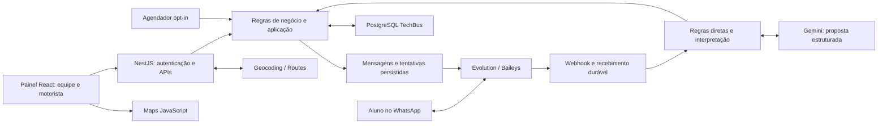

# TechBus — guia de estudo e apresentação do andamento

**Consolidação: 17/11/2026 · Autora do TCC: Taís · Sistema para gestão de transporte universitário.**

Este material reúne o trabalho registrado no repositório, as funcionalidades presentes no código, as decisões que mudaram ao longo do desenvolvimento e o que ainda falta. Foi preparado para estudar e apresentar o andamento, não como declaração de conclusão ou de operação em produção. As últimas evidências funcionais consultadas chegam a 12/11/2026. Nesta consolidação houve leitura do código e das evidências, sem nova execução das suítes, consulta aos bancos, leitura de credenciais ou envio de mensagens. Não representa consulta integral de conversas anteriores nem do texto acadêmico externo.

**Como estudar:** leia primeiro as seções 1–4; depois arquitetura e integrações nas seções 5–8; use as seções 9–13 para explicar testes, pendências e demonstrar o sistema. O [inventário técnico](inventario-tecnico-andamento.md) complementa este guia com arquivos, rotas HTTP, tabelas, migrações e documentos de cada incremento.

## 1. O que é o projeto e em que estágio está

O TechBus organiza a demanda diária e a operação de uma empresa de transporte universitário noturno que atende Unimater e Unidep. Reúne cadastro de alunos e vigências, calendário universitário, pontos e grupos, confirmação de ida e volta, comunicação por WhatsApp, apoio à escolha de veículos, itinerários e consulta do motorista. WhatsApp e inteligência artificial são componentes do sistema; o projeto não se resume a um chatbot.

O núcleo do backend e o painel conectado estão implementados localmente. Há autenticação própria, regras operacionais, persistência, processamento de mensagens, agendador e prévia de percurso com Google Maps. Existem testes automatizados e ensaios reais de integrações específicas. **Ainda falta comprovar a cadeia operacional completa pelo WhatsApp, concluir a avaliação acadêmica e preparar a hospedagem.** Não há evidência suficiente para declarar operação contínua em produção ou ganhos quantitativos para a empresa.

Formulação possível para abrir a apresentação:

> “O TechBus é um sistema de apoio à gestão do transporte universitário noturno. Ele centraliza cadastros, confirmações diárias, disponibilidade da frota e itinerários, utilizando WhatsApp como canal de comunicação e IA como apoio à interpretação. O backend e o painel já estão implementados e testados localmente, com ensaios reais de WhatsApp, Gemini e Google Maps. Neste momento, o foco restante é validar o fluxo completo em condições controladas, preparar a disponibilização e executar a avaliação acadêmica.”

### Problema, objetivo e contribuição

O problema operacional tratado é transformar respostas individuais, mudanças de planos e restrições de transporte em uma lista confiável para cada etapa da noite. As informações precisam respeitar prazos, vigência, calendário, capacidade e locais, inclusive quando chegam duplicadas, atrasadas ou ambíguas.

O objetivo funcional é centralizar essas informações e apoiar decisões da empresa, reduzindo a necessidade de conciliá-las manualmente. Redução de tempo, erros ou custos é **benefício esperado a medir**, não resultado já demonstrado. A contribuição técnica está na combinação entre comunicação em linguagem natural, regras explícitas no servidor e planejamento operacional rastreável.

## 2. Escopo vigente e operação da empresa

O recorte é uma empresa, transporte noturno e duas universidades. A operação envolve São Lourenço do Oeste, fiscalização e Pato Branco. Não há gestão financeira, cobrança, mensalidade, matrícula pública, aplicativo de aluno ou comprovação de presença.

1. **Coleta:** alunos são recolhidos em pontos cadastrados, em grupos definidos pela empresa, até a fiscalização.
2. **Intermunicipal:** a demanda é separada por universidade para o deslocamento a Pato Branco. O ciclo considera ida e retorno da universidade.
3. **Desembarque/distribuição:** após o retorno, os grupos locais de volta atendem os pontos de desembarque cadastrados.

Grupos de ida e volta podem ser diferentes. Pontos e distribuição são definidos pela equipe. Não há criação automática de grupos, balanceamento automático ou redistribuição automática de passageiros.

### Regras que precisam estar claras na apresentação

| Tema | Regra atual |
| --- | --- |
| Elegibilidade | Aluno ativo, vigência válida e universidade operando. Consulta habitual também considera os dias habituais do aluno. |
| Vigência | Datas inicial e final inclusivas; sem períodos invertidos ou sobrepostos para o mesmo aluno. Contrato representa vigência, não financeiro. |
| Dia extra | Pode ser iniciado pelo aluno antes das 17h com vigência e operação válidas, mesmo fora de seus dias habituais. |
| Calendário | Exceção por data prevalece sobre a programação semanal. Ausência de configuração não significa operação. |
| Consulta e lembretes | Consulta às 05h; lembretes às 11h, 13h e 16h somente para pendências pertinentes. |
| Prazo de confirmação | Recebimento durável no backend estritamente antes de 17:00:00, em America/Sao_Paulo. |
| “Vou” | Em regra inclui ida e volta; recusa explícita anterior de volta é preservada até mudança explícita. |
| “Só ida” / “só volta” | Confirma apenas o trecho explicitado. |
| Sem resposta | Não entra na demanda nem ocupa assento. |
| Ida indecisa | Não confirma ida. |
| Ida confirmada e volta indecisa | No fechamento, volta por padrão se ainda elegível, com origem marcada e comunicação prevista. Recusa explícita não vira volta padrão. |
| Depois das 17h | Aluno apenas cancela volta já confirmada, estritamente antes de 22:00:00. Não faz nova confirmação nem troca de ponto. |
| Correção da equipe | Admin/operador podem corrigir com justificativa e validações, sem inferir volta por uma ida manual nem enviar WhatsApp automaticamente. |
| Alteração cadastral | Desativação ou mudança de calendário não apaga confirmações existentes; exige revisão quando necessário. |
| Local pendente | Confirmação pode contar na demanda, mas o local precisa ser resolvido para concluir a operação/itinerário correspondente. |
| Padrão de local | Alteração diária não muda o padrão automaticamente; mudança de padrão exige pedido/consentimento explícito e evidência. |
| Consulta operacional | Somente o dia atual de São Paulo. A virada do dia muda a operação consultada, sem apagar registros técnicos. |
| Presença | Confirmação significa intenção de uso; não há check-in ou prova de embarque. |

### Recomendação de veículo — exemplo para explicar

A recomendação existe **somente no intermunicipal**, por universidade. O sistema procura o menor veículo disponível que comporte `max(ida, volta)`. Se houver 18 confirmados na ida e 23 na volta, a capacidade necessária é 23, e não 41. Entre veículos de mesma capacidade, as opções são equivalentes. A empresa pode escolher um veículo maior, desde que disponível e suficiente.

Se nenhum veículo atende, o sistema sinaliza insuficiência para solução manual. Não divide automaticamente a demanda. Coleta e desembarque têm escolha manual. A disponibilidade é semanal por dia, com exceção por data, sem faixas de horário de viagem. As etapas são sequenciais: o mesmo veículo pode atender etapas diferentes, mas não dois grupos na mesma etapa; no intermunicipal atende uma universidade. Há proteção correspondente contra conflito de motorista no mesmo trecho da mesma etapa.

## 3. Tudo que foi construído, por área funcional

### Acesso e autenticação

- Três perfis fixos: administrador, operador e motorista; exatamente um por usuário.
- Admin gerencia contas, perfis e recuperação; admin/operador gerenciam cadastros e operação; motorista consulta apenas suas atribuições confirmadas, com passageiros e telefones.
- Proteção do último administrador ativo, inclusive em alterações concorrentes. Vínculo entre conta e motorista explícito e exclusivo.
- Login individual por e-mail/senha, sem cadastro público, conta padrão ou e-mail automático de recuperação.
- Senha temporária de 24 horas e troca obrigatória no primeiro acesso/recuperação. Contexto de troca restrito e temporário.
- Sessão opaca revogável, expiração por uma hora de inatividade ou 12 horas absolutas; logout e desativação invalidam acesso.
- Senhas com scrypt e salt aleatório; comparação segura e limitação de tentativas/trabalho criptográfico. Banco guarda digest do token, não o token aberto.
- Token do painel somente em memória: abrir/recarregar exige login. Autorização também é verificada no servidor, não apenas pelo menu.
- Bootstrap e recuperação excepcional do administrador por CLI local restrita.

No painel existe **Novo acesso** para criar conta e vincular motorista. Gestão/recuperação completa de contas existentes ainda depende das APIs/CLI; não apresentar um painel completo de administração de contas que ainda não existe. Evidências: [B18.1](../specs/017-autenticacao-propria/verification.md) e [painel](../specs/021-painel-operacional/verification.md).

### Cadastros, vigências e calendários

Catálogo das duas universidades, alunos com telefone único, ativação, dias habituais e contratos por vigência. Zero dias habituais é válido para uso exclusivamente extra. Calendário semanal por universidade e exceções por data; correções preservam confirmações existentes e passam a valer para novas avaliações. Atualizações usam revisão/versão para detectar edição concorrente. Evidências: [cadastros](../specs/003-cadastros-vigencias/verification.md), [calendários](../specs/004-calendarios-elegibilidade/verification.md).

### Grupos, pontos e endereços

Grupos manuais por sentido, pontos de embarque e pontos fixos de desembarque, padrões por aluno e ordem manual. O modelo mantém regiões e referências legadas por compatibilidade. Endereços livres antigos não foram convertidos silenciosamente em pontos aprovados.

O endereço próprio estruturado inclui logradouro/localização, número textual ou indicação sem número, bairro, cidade, UF, Brasil, CEP e complemento. Bairro, CEP e complemento são opcionais. A referência da parada é separada do endereço e aparece no itinerário/motorista. UUIDs, grupos, padrões e ordem foram preservados; o texto antigo só recebe detalhamento por ação explícita. Validação estrutural verifica o preenchimento, não a existência real do endereço. Evidências: [pontos fixos](../specs/022-desembarque-fixo/verification.md) e [endereços](../specs/025-enderecos-pontos/verification.md).

### Jornada, prazos, fechamento e correções

Estados diários por aluno e sentido, comandos explícitos, recebimento durável, preservação de recusa, cancelamento, fechamento da volta padrão e conciliação de interpretação atrasada. A repetição de um comando não repete seu efeito; repetir fechamento não restaura volta cancelada. Revisão da equipe registra justificativa e autoria; mensagens anteriores revisadas não desfazem a correção. Novo cancelamento válido continua permitido. Evidências: [jornada](../specs/006-jornada-comandos/verification.md), [fechamento](../specs/007-fechamento-cancelamento/verification.md), [concorrência](../specs/008-idempotencia-concorrencia/verification.md), [correções](../specs/012-correcoes-equipe/verification.md).

### Frota, planejamento, consultas e itinerários

Veículos com identificação, placa, tipo e capacidade; motoristas; disponibilidade semanal por dia e exceções. Rascunho antes do fechamento, recomendação intermunicipal e confirmação após fechamento e resolução de pendências. Mudanças de demanda/cadastro sinalizam revisão; ocupações confirmadas são preservadas até substituição válida, sem liberar ou trocar ônibus automaticamente.

A interface atual integra planejamento e itinerário nas abas **Ida, Volta e Intermunicipal**, com escolhas de veículo/motorista, filtros e prévias por grupo. Planejamento não é mais uma página independente. Há ordem padrão e publicação explícita do itinerário; modificar a ordem padrão não muda silenciosamente a última publicação. Cancelamentos retiram paradas vazias. Confirmado sem posição exige inserção manual antes de publicar itinerário completo.

Consulta administrativa consolidada e visão restrita do motorista. Sem interface de histórico de operações passadas. Evidências: [frota](../specs/010-frota-disponibilidade/verification.md), [alocação](../specs/011-alocacao-planejamento/verification.md), [consultas](../specs/014-consultas-operacionais/verification.md), [itinerário](../specs/015-trajeto-contingencia/verification.md), [revisão diária 024](../specs/024-itinerario-diario/verification.md).

### Comunicação, IA, contexto e agendador

Recepção autenticada de eventos Evolution, identificação de contato, deduplicação e persistência; regras diretas e Gemini; validação de proposta; processamento interno opt-in; aplicação transacional da jornada; preparação e despacho de recibos; uma pergunta de esclarecimento por cadeia; encaminhamento à equipe se a ambiguidade persistir; consultas/lembretes e fechamento por executor operacional. Os detalhes e a diferença entre implementação e ensaio real estão nas seções 6 e 9.

### Mapa e prévia de percurso

Página administrativa com Google Maps, geocodificação explícita, escolha de candidato, conferência no mapa, origem/destino informados pela equipe e cálculo de percurso na ordem manual. Permite pontos cadastrados ou confirmados hoje e trecho direto/intermunicipal. Mostra linha do percurso, distância e duração estimada. Não otimiza a sequência de paradas. Evidências: [Maps 026](../specs/026-mapas-rotas/verification.md).

### Interface efetivamente disponível

Login/troca obrigatória; Operação do dia; Alunos e vigências/locais; Calendário; Grupos e locais; Frota; Itinerários com planejamento integrado; Mapa e rotas; Mensagens; Novo acesso para admin; Minhas viagens para motorista. Há formulários, mensagens de erro compreensíveis, tratamento de sessão expirada, estados de pendência e verificações de layout em desktop/celular. A existência de `planning.tsx` no código não significa uma página separada no menu atual.

## 4. Evolução e decisões que mudaram o projeto

| Marco | Trabalho e significado |
| --- | --- |
| Preparação, outubro | Consolidação de escopo, requisitos, fluxos, arquitetura, dados, API, backlog e decisões. PRM 2026 usado como referência técnica autorizada, sem copiar automaticamente suas escolhas. |
| B00–B02 | Seleção de método/skills, stack, base NestJS, ambiente Node/PostgreSQL local isolado, migrações, saúde e testes. |
| B03–B06 | Autorização, alunos/vigências, calendários/elegibilidade, grupos/locais e padrões. |
| B07–B10 | Jornada, fechamento/cancelamento, idempotência/concorrência e sequência de locais. A sugestão da quarta utilização foi implementada nesse período e depois retirada da entrega. |
| B11–B17 | Frota, recomendação/alocação, correções, comunicação persistente, consultas, itinerário manual e revisão integrada R01–R22/O01. |
| 27/10 | PostgreSQL local e autenticação própria confirmados; Evolution integrada diretamente pelo NestJS, sem n8n. |
| 28/10 | Autenticação implementada; Evolution pareada e primeiro texto real persistido, inicialmente de contato não cadastrado. |
| 29/10 | Ensaio Gemini real; política de horário original do fornecedor; aplicação da proposta, worker, recibo transacional e despachante. |
| 04/11 | Painel antecipado; pontos fixos de desembarque; cálculo de rotas e quarta utilização retirados da entrega naquele momento; testes manuais anteriores adiados. |
| 05/11 | Contexto de conversa e resolução de nomes inequívocos de pontos fixos implementados. |
| 06/11 | Agendador operacional implementado e validado localmente. |
| 09/11 | Ensaio parcial com quatro consultas em estado `sent`; cadeia completa ainda aberta. |
| 11/11 | Itinerário em três abas, disponibilidade por dia/etapa, consulta apenas de hoje e endereço estruturado dos pontos. |
| 12/11 | Maps, Geocoding e Routes implementados e ensaiados com serviços reais; sequência permanece manual. |
| 17/11 | Consolidação documental para preparação da apresentação; sem nova entrega funcional nesta revisão. |

**Decisões superadas que não devem ser apresentadas como atuais:** Supabase Auth como login; faixas horárias de disponibilidade; consulta da operação anterior; endereço livre de desembarque como fluxo principal; ausência de worker/contexto/agendador; mapas inteiramente futuros; sugestão automática da quarta utilização como requisito vigente. Preservar seu registro histórico ajuda a explicar a evolução, mas não autoriza misturar versões do escopo.

O cálculo de percurso de 12/11 não reintroduziu otimização, agrupamento automático, validação automática de área ou acompanhamento ao vivo. A implementação histórica de B10 também não significa que a sugestão da quarta utilização voltou ao escopo vigente.

## 5. Tecnologias e arquitetura

As versões abaixo foram extraídas dos manifestos e registros locais, não são indicação de versões mais recentes nem nova auditoria de compatibilidade. Backend e frontend têm manifestos/lockfiles separados.

| Tecnologia | Versão registrada | Papel no TechBus |
| --- | --- | --- |
| Node.js / npm | 24.22.1 / 11.17.0 no backend/ambiente documentado | Executar JavaScript no servidor e gerenciar dependências/scripts. |
| TypeScript | Backend 5.8.3; frontend 7.0.2 | Tipagem durante o desenvolvimento; não substitui validação de entrada em runtime. |
| NestJS | Core/common/platform-express 11.2.7; CLI 11.0.10 | Servidor modular, HTTP, injeção de dependências e ciclo de vida. Adaptador Express. |
| PostgreSQL | 17.11 no ambiente registrado | Persistência relacional, integridade e transações. |
| TypeORM / integração Nest | 0.3.31 / 11.0.0 | DataSource, conexão, transações e migrações. O projeto também escreve SQL explícito; não é um modelo inteiro de entidades decoradas. |
| pg | 8.16.3 | Driver PostgreSQL. |
| React / React DOM | 19.3.1 | Interface do painel. |
| Vite / plugin React | 8.3.5 / 6.2.1 | Servidor de desenvolvimento e build do frontend. Não é o servidor do backend. |
| Tailwind CSS | 4.3.4 | Estilização da interface. |
| Componentes no padrão shadcn/ui | Código local; não uma versão única instalada de “shadcn” | Composição de componentes, com Radix Slot 1.5.0, CVA 0.7.1, clsx 2.1.1 e tailwind-merge 3.7.0. |
| Lucide React | 1.68.0 | Ícones. |
| Evolution API / Baileys | Evolution 2.3.7; fonte/patches documentados | Canal WhatsApp de testes, sessão pareada e webhook. Não apresentar como WhatsApp Cloud API oficial. |
| Gemini API | Modelo registrado `gemini-3.1-flash-lite` | Propostas estruturadas de interpretação de linguagem natural. |
| Google Maps Platform | Geocoding, Routes e Maps JavaScript | Localização, cálculo de percurso e visualização. |
| Jest / ts-jest / Supertest | 30.0.0 / 29.4.5 / 7.1.3 | Testes unitários, integração e HTTP no backend. |
| Playwright | 1.64.1 | Testes de navegador, com Edge no ambiente documentado. |
| ESLint / Prettier | Backend 9.18.0 / 3.4.2 | Análise estática e formatação. |
| Git, PowerShell e Spec Kit | Configuração local do projeto | Histórico de código, scripts de ambiente e organização incremental de especificações/tarefas/evidências. |

### Organização do sistema

O backend é uma aplicação modular, não um conjunto de microserviços. Controllers recebem requisições; serviços de aplicação coordenam casos de uso; domínio concentra decisões; infraestrutura executa persistência e integrações. Há interfaces/portas substituíveis nos testes, inclusive relógio e transportes externos. Evolution é um processo separado, com banco próprio, sem acesso irrestrito ao banco TechBus.

Pastas principais: `access`, `registry`, `journey`, `fleet`, `operation`, `itinerary`, `messaging`, `whatsapp`, `interpretation`, `maps`, `health`, `config`, `shared` e `infrastructure`. Frontend usa páginas em `frontend/src/pages`, componentes locais e cliente HTTP em `frontend/src/lib/api.ts`. A autenticação HTTP usa o token em memória. A interface chama o servidor; não se conecta diretamente ao PostgreSQL.

### Persistência e integridade

As migrações versionadas evoluem o esquema explicitamente, com `synchronize: false`; o runtime não inventa tabelas a partir do código. O DataSource de migrações tem usuário próprio e `entities: []`. O esquema do domínio é `app`. Os dados incluem usuários/sessões, alunos/vigências/calendários, locais/padrões, jornadas/recibos, frota/disponibilidade, planos/ocupações, mensagens/tentativas e contexto de conversa.

São utilizados vínculos e restrições de banco, transações, bloqueios e versões para impedir inconsistências concorrentes. A confirmação de viagem e seu recibo são persistidos atomicamente; uma falha antes do commit não deve deixar só metade da operação. Chamadas externas são realizadas fora dos locks longos, com reservas/revalidação nas fronteiras adequadas. Isso reduz duplicidade e conflito, mas não promete entrega externa “exatamente uma vez”.

O [inventário técnico](inventario-tecnico-andamento.md) relaciona as tabelas declaradas e todas as migrações encontradas. É inventário de fonte, não inspeção do esquema instalado no banco em 17/11.

## 6. WhatsApp e inteligência artificial: como realmente funciona

1. Evolution recebe a mensagem e chama o webhook autenticado.
2. Backend registra o evento de modo durável, identifica contato/instância e elimina duplicatas. Contato desconhecido não vira aluno automaticamente.
3. O processamento reserva trabalho persistente. O horário de recebimento é preservado antes de qualquer chamada de IA.
4. Regras diretas tratam comandos conhecidos; Gemini é usado quando necessário. Respostas curtas sem contexto inequívoco não confirmam por presunção.
5. A proposta passa por formato estrito e validações de aluno, prazo, elegibilidade, locais, ordem e revisão.
6. Pedido claro e válido é aplicado sem reconfirmação geral; jornada e recibo são gravados na mesma transação.
7. Ambiguidade pode gerar uma pergunta objetiva. A resposta citada precisa corresponder à pergunta, aluno, telefone, instância e dia. Se persistir dúvida, a equipe revisa.
8. O despachante reserva a tentativa antes do envio, revalida pertinência e registra resultado. Resultado incerto não é reenviado automaticamente.

### A IA não decide a regra de negócio

O Gemini recebe conteúdo necessário à interpretação e instruções, sem ferramentas com acesso irrestrito ao banco. Retorna uma proposta estruturada, não executa SQL nem escolhe permissões. O adaptador usa limite de saída registrado de 1024 tokens, timeout de 20 segundos e sem retry automático. A validação do backend é obrigatória tanto para regras diretas quanto para IA.

Um ensaio direto mostrou que “sim” sem contexto podia ser interpretado indevidamente como ida. O fluxo com regra direta primeiro manteve esse caso ambíguo. Esse achado explica por que não basta “confiar no modelo” e por que 7/7 frases de teste não são prova de precisão geral. [Evidência Gemini](../specs/019-interpretacao-mensagens/verification.md).

### Dois horários, duas funções diferentes

- **Recebimento durável no backend:** define se o pedido chegou antes do prazo. Exemplo: recebido às 16h59 e interpretado às 17h01 pode preservar o direito de confirmação; recebido às 17h01 não ganha prazo retroativo.
- **Horário original do fornecedor com origem validada:** ajuda a ordenar mensagens conforme política aprovada em 29/10. Foi necessário um patch reproduzível Evolution/Baileys para preservar essa evidência. Não é prova absoluta; empates, ausência de evidência e conflitos ficam pendentes.

Contexto não resolve ordem incerta nem reabre prazo. Uma mensagem anterior pendente pode bloquear sucessoras. Correções administrativas e evidências de revisão precisam ser preservadas.

### Mensagens preparadas, aceitas e entregues são coisas diferentes

`prepared` significa conteúdo persistido; `sending` significa tentativa reservada/em envio; `sent` significa aceite do provedor. Não comprova entrega nem leitura no aparelho. Timeout ou interrupção podem deixar resultado incerto, que exige análise em vez de reenvio cego. Falha de comunicação não apaga uma viagem confirmada.

### Agendador operacional

Implementado com ciclo imediato ao iniciar e a cada 30 segundos, sem sobreposição de ciclo na mesma instância. Reutiliza `MessageService.tick/dispatch` e fechamento, com falha por aluno isolada. Recupera o contato mais recente ainda pertinente; não envia todos os lembretes perdidos nem novos lembretes após as 17h.

`OPERATIONS_SCHEDULER_ENABLED`, processamento Evolution, envio e allowlist são controles distintos. Estar implementado não significa estar habilitado ou rodando agora. O launcher seguro do painel desativa o agendador e integrações de mensagens naquele processo. [Guia de ativação](../specs/023-agendador-operacional/quickstart.md).

## 7. Mapas: alcance e limites

Geocoding transforma o endereço buscado em candidatos de localização. A equipe seleciona e confere o candidato no mapa. Routes calcula o trajeto entre origem, paradas em ordem manual e destino. Maps JavaScript apresenta mapa, marcadores e linha do percurso.

O backend verifica acesso, pontos ativos, ordem e revisão antes/depois da chamada externa. Se a prévia muda durante o cálculo, a resposta é descartada (`PREVIEW_CHANGED`). Local legado fora do catálogo fixo pode bloquear cálculo, exigindo revisão.

Resultados Google, coordenadas escolhidas, conferência e percurso ficam somente na sessão da tela; não são gravados como cadastro permanente. Reabrir a tela exige nova localização/conferência. Há limite de 25 intermediários. Duração considera condução sem trânsito ao vivo e sem tempo de embarque; adequação ao ônibus depende da equipe.

Não há otimização da ordem, rastreamento GPS, previsão acompanhada de chegada, aviso automático às 18h ou validação automática da área atendida. Termos/privacidade do fornecedor, cotas e restrições das chaves no domínio final precisam ser revisados antes da disponibilização pública. [Plano efetivo](../specs/026-mapas-rotas/plan.md).

## 8. Ambiente, execução e método de desenvolvimento

O ambiente documentado é local em Windows/PowerShell, com ferramentas privadas em `.local`, PostgreSQL de desenvolvimento e de testes separados e Evolution isolada. Backend em `127.0.0.1:3000`, painel em `127.0.0.1:5173`, PostgreSQL dev/test em 55432/55433 e Evolution em 8085 com banco próprio em 55434. São endereços do ambiente local, não URLs públicas.

O launcher `scripts/painel-local.ps1` permite iniciar `-Service api` e `-Service front`. O modo comum do painel grava no banco dev e desativa Evolution, processamento, envio, Gemini e scheduler apenas no processo; não é uma simulação sem persistência. Não serve para demonstrar automação real de WhatsApp. Maps tem sua configuração própria. Procedimento completo em [frontend/README](../frontend/README.md).

Configuração e segredos ficam em arquivos privados; exemplos versionados documentam variáveis. Não incluir senhas, telefones, chaves ou sessões na apresentação. Não assumir que processos estão ativos ou que flags privadas mantêm hoje o valor observado em uma data anterior.

### Como o desenvolvimento foi organizado

Foi utilizado desenvolvimento incremental orientado por especificações (Spec Kit): especificação, plano, tarefas e evidências de verificação, com decisões de negócio documentadas. Os incrementos mais recentes também têm registros mais enxutos de plano/verificação. TDD foi adotado nas regras críticas: teste do comportamento, implementação e validação da regressão. Há testes unitários, integração com PostgreSQL, testes HTTP e navegador. O relógio substituível permite validar fronteiras de horário sem esperar o dia real.

O uso de Codex e skills apoiou especificação, implementação e revisão; não constitui resultado científico por si só. Deve ser relatado conforme as regras acadêmicas da instituição. A referência PRM 2026 orientou organização, sem autorizar mudanças no projeto externo nem presumir bibliotecas iguais.

O diretório de trabalho tinha diversas alterações e arquivos ainda não registrados em commit nesta consulta, inclusive incrementos recentes. Portanto, “existe no workspace” não significa “está publicado ou preservado em um commit final”. Esta consolidação não fez commit/push nem alterou código funcional.

## 9. Evidências de testes e ensaios

**Não somar contagens de regressões sucessivas:** grande parte dos testes se repete entre entregas. “Testes distintos considerando reexecução” significa que uma execução parcial falhou e os cenários correspondentes foram revalidados, sem contar o mesmo teste novamente.

| Marco | Evidência registrada | O que permite afirmar |
| --- | --- | --- |
| B17 | Matriz R01–R22/O01 e cenário integrado local | Núcleo interno revisado; fornecedores ainda simulados naquele marco. |
| Autenticação, 28/10 | 374 testes distintos/68 suítes; tipos, lint e build | Regras de acesso e autenticação local verificadas. |
| Gemini, 29/10 | 7/7 casos no fluxo regras→Gemini, seis chamadas HTTP 200 e um caso local | Adaptador/modelo responderam nesse conjunto sintético, sem medir precisão geral. |
| Despacho, 29/10 e revisão 04/11 | 460 testes/78 suítes; transporte substituto | Aplicação, reserva e despacho verificados localmente, sem comprovar entrega real. |
| Painel inicial | 9 testes de navegador e ensaio navegador→NestJS→PostgreSQL test | Login/cadastro/consultas/logout conectados, sem noite completa. |
| Pontos fixos, 04/11 | 462 testes backend distintos, 10 de navegador e ensaio com banco test | Catálogo, padrão, jornada e itinerário com pontos fixos. |
| Contexto, 05/11 | 493 testes backend distintos, 11 de navegador; tipos/lint/build | Pergunta, resposta citada e locais fixos verificados; transporte substituto. |
| Agendador, 06/11 | 504 testes/82 suítes; tipos/lint/build | Executor e recuperação validados localmente. |
| WhatsApp, 09/11 | Quatro mensagens do slot 05 com estado `sent`, instância `open` | Aceite pelo provedor; recebimento nos aparelhos e respostas aplicadas ainda não comprovados pelo registro. |
| Itinerário diário, 11/11 | 507 testes backend distintos e 13 de navegador | Modelo diário/etapas, três abas e disponibilidade revisados. |
| Endereços, 11/11 | 518 testes backend distintos e 14 de navegador; tipos/lint/build | Endereço estruturado e legado preservado, com persistência em test. |
| Maps, 12/11 | 20 testes backend dirigidos e 15 de navegador; tipos/build/lint | Integração de mapa e invalidação da prévia verificadas. Não é uma nova regressão completa de 538 testes. |
| Maps real, 12/11 | Geocoding/Routes HTTP 200, Maps JS carregado e percurso de 0,9 km/~4 min | Ensaio real com endereços públicos e usuário temporário de teste; não é trajeto operacional da empresa. |

No ensaio Maps integrado, a identidade foi simulada apenas no teste e removida ao final; o login real não foi repetido com a senha da usuária. A captura móvel foi verificada a 390 px, sem overflow horizontal. Os testes do painel com APIs substitutas não equivalem por si só a banco real; os ensaios `real-smoke` fornecem evidência separada de persistência.

Fontes: [B17](../specs/016-revisao-backend/coverage.md), [B18.1](../specs/017-autenticacao-propria/verification.md), [B18.3](../specs/019-interpretacao-mensagens/verification.md), [painel](../specs/021-painel-operacional/verification.md), [022](../specs/022-desembarque-fixo/verification.md), [020](../specs/020-contexto-conversa/verification.md), [023](../specs/023-agendador-operacional/verification.md), [ensaio parcial](../specs/023-agendador-operacional/ensaio-real.md), [024](../specs/024-itinerario-diario/verification.md), [025](../specs/025-enderecos-pontos/verification.md), [026](../specs/026-mapas-rotas/verification.md).

## 10. O que falta, o que foi adiado e o que não pertence ao MVP

| Situação | Trabalho restante | Critério de conclusão |
| --- | --- | --- |
| Validação pendente | Retomar falhas relatadas nos testes manuais de interpretação | Reproduzir casos, registrar causa/resultado e verificar correção quando necessária. Não presumir que incrementos posteriores resolveram todos. |
| Ensaio parcial | Concluir cadeia WhatsApp→interpretação→jornada→recibo→painel, incluindo troca de ponto, esclarecimento, revisão, fechamento e cancelamento | Evidências por cenário e horário real, incluindo observação no aparelho quando houver alegação de entrega. T019 de B18.3 continua aberta. |
| Preparação operacional | Conferir calendários, vigências, pontos, grupos, ordem, frota e vínculos reais autorizados | Cadastros coerentes e pendências resolvidas. Não usar estado histórico do banco como diagnóstico atual. |
| Migração de uso | Recadastrar disponibilidade por dia | Faixas antigas foram preservadas, mas não convertidas automaticamente em disponibilidade diária. |
| Validação de mapa | Conferir garagem, destinos, entradas e paradas reais com a equipe | Percurso representativo revisado; sem coordenadas operacionais inventadas. |
| Disponibilização pendente | Escolher e configurar hospedagem de frontend, backend, PostgreSQL e Evolution | Implantação reproduzível, domínio/HTTPS, segredos, execução contínua e ensaio no ambiente final. Railway/Hetzner são opções históricas, não escolha fechada. |
| Operação contínua pendente | Definir backup/restauração, monitoramento, recuperação e manutenção | Procedimentos definidos e testados; não basta deixar o computador ligado. |
| Política pendente | Definir retenção dos registros e condições de uso real/privacidade | Decisões documentadas; não há expurgo automático aprovado. |
| Interface parcial | Administração completa de contas existentes | Avaliar necessidade para entrega; hoje parte depende de API/CLI. Não é ausência de autenticação. |
| Avaliação acadêmica pendente | Definir protocolo comparativo, amostra, métricas e executar | Resultados observados e analisados; sem percentuais de melhoria inventados. |
| Entrega acadêmica | Consolidar texto, figuras, limitações, resultados e ensaio de apresentação | Alinhar com orientador e exigências da instituição. Este guia é material de estudo, não substitui a monografia. |
| Preservação/versionamento | Revisar e registrar a versão final do trabalho | Código/documentos/evidências organizados, sem incluir segredos. Não foi executado nesta consolidação. |

### Adiado ou excluído da entrega vigente

- Sugestão automática de mudança de padrão após a quarta utilização: implementação histórica B10 preservada, retirada da entrega em 04/11.
- Criação automática de grupos, redistribuição e balanceamento automático: futuros.
- Otimização da ordem de paradas: não implementada; cálculo Google respeita ordem manual.
- Rastreamento/posição ao vivo e avisos de chegada aos alunos, inclusive proposta das 18h: futuros, sem especificação operacional fechada.
- Validação automática da área e aceitação de qualquer endereço livre: não entregues; fluxo atual usa pontos fixos.
- Financeiro, cobranças, autocadastro, múltiplas empresas, histórico operacional consultável e comprovação de presença: fora do MVP.
- Áudio/imagem/figurinha como intenção de viagem: fora da interpretação de texto; não afirmar transcrição ou compreensão de mídia.

### Próxima sequência sugerida

Retomar os casos manuais → completar ensaio controlado nos horários válidos → corrigir/revalidar falhas → preparar hospedagem e operação contínua → executar avaliação acadêmica → consolidar resultados e apresentação. Essa sequência é proposta de trabalho, não novo compromisso de prazo ou autorização para ativar envios.

As datas 08/11 (backend), 22/11 (funcional), 23–29/11 (reserva) e 30/11–05/12 (defesa) aparecem como metas históricas; houve indicação posterior de entrega de sistema/texto na semana de 16/11. Não declarar cumprimento ou data oficial de defesa sem confirmação de Taís/orientador.

## 11. Roteiro para apresentar o andamento

Roteiro sugerido de 10–12 minutos, ajustável ao tempo solicitado pelo orientador:

| Parte | Conteúdo | Apoio visual sugerido |
| --- | --- | --- |
| 1. Contexto e problema | Empresa, universidades e dificuldade de conciliar demanda/alterações | Esquema coleta→intermunicipal→desembarque. |
| 2. Objetivo e escopo | O sistema completo, papel do WhatsApp/IA e limites do MVP | Lista curta dos módulos. |
| 3. Regras principais | Elegibilidade, 17h/22h, sem resposta e max(ida, volta) | Um exemplo de aluno e um de capacidade. |
| 4. Arquitetura | React, NestJS, PostgreSQL e integrações | Diagrama da seção 5. |
| 5. Funcionalidades | Cadastro, operação, itinerário, motorista e mapa | Demonstração curta ou capturas selecionadas. |
| 6. Qualidade e estágio | Testes por camada, integrações reais parciais e limites | Tabela resumida de evidências, sem somar regressões. |
| 7. Próximos passos | Ensaio completo, hospedagem e avaliação | Três prioridades com critérios de conclusão. |

### Demonstração sugerida

1. Entrar com conta já autorizada e explicar o perfil.
2. Mostrar aluno, vigência e pontos habituais, usando dados sintéticos autorizados.
3. Mostrar calendário e explicar exceção por data.
4. Abrir Operação do dia, explicar estados e pendências. Não cadastrar confirmação fictícia em dados reais para melhorar a demonstração.
5. Abrir Itinerários, mostrar três abas, ordem manual, escolhas e recomendação intermunicipal.
6. Mostrar visão do motorista com conta/vínculo adequado, se houver cenário preparado.
7. Mostrar mapa com endereços públicos ou pontos autorizados, seleção/conferência e estimativa.
8. Explicar o caminho de WhatsApp por evidência registrada ou ensaio previamente preparado. O launcher seguro não executa esse fluxo.

Se a apresentação ocorrer antes das 17h, mostre rascunho/prévia e explique o bloqueio de confirmação definitiva; não contorne o relógio. Se faltar internet, use evidências identificadas como capturas anteriores, sem fingir execução ao vivo. Confirme antes o acesso, os serviços locais e os dados que serão expostos.

### Afirmações seguras e afirmações a evitar

| Pode afirmar | Evite afirmar |
| --- | --- |
| “O núcleo foi implementado e validado localmente.” | “O sistema inteiro já está em produção.” |
| “Há ensaios reais de integrações específicas.” | “Toda a noite já funciona sem intervenção.” |
| “A IA propõe uma interpretação e o backend valida.” | “A IA decide quem pode viajar e altera o banco livremente.” |
| “O Google calcula o percurso na ordem definida.” | “O sistema otimiza todas as rotas.” |
| “Quatro consultas foram aceitas pelo provedor no ensaio.” | “Os quatro alunos receberam, leram e responderam.” |
| “A última regressão ampla registrada em endereços cobriu 518 testes distintos.” | “Todos os testes foram executados hoje” ou somar testes de todas as entregas. |
| “Esperamos reduzir trabalho manual; isso será avaliado.” | “Reduziu custos/erros em X%” sem experimento. |

## 12. Perguntas prováveis do orientador ou banca

**Por que não usar apenas WhatsApp?** Porque conversar não resolve sozinho vigência, calendário, prazos, capacidade, vínculos, conflitos e atualização de itinerários. O sistema estrutura e valida a informação recebida pelo canal.

**Por que NestJS, React e PostgreSQL?** NestJS organiza os casos de uso e integrações no servidor; React atende o painel interativo; PostgreSQL sustenta vínculos, restrições e transações. São escolhas do projeto, não prova de superioridade universal sobre outras stacks.

**Por que regras antes da IA?** Comandos conhecidos têm tratamento previsível; linguagem variável pode ser interpretada pelo modelo, sempre com validação. O caso “sim” sem contexto mostrou a necessidade dessa barreira.

**E se a IA errar ou estiver indisponível?** Proposta inválida ou ambígua não deve gerar confirmação presumida. Há diagnóstico/pendência e revisão da equipe; não se promete interpretação perfeita.

**Como evita duplicidade?** Identificadores, reservas persistentes, transações e idempotência protegem efeitos locais. Para envio externo incerto, não há reenvio cego nem promessa de entrega exatamente uma vez.

**Como trata mensagem atrasada?** Prazo depende do recebimento durável; processamento tardio preserva esse instante. Ordenação usa evidência original validada quando disponível, com conflitos encaminhados à equipe.

**Por que max(ida, volta)?** O veículo atende trechos em momentos diferentes; precisa suportar o maior dos dois contingentes, não a soma dos passageiros de ambos.

**O mapa garante caminho adequado ao ônibus?** Não. Ele fornece prévia e estimativa; a empresa confere paradas, entradas e adequação. Não inclui tempo de embarque nem monitoramento ao vivo.

**Como os dados são protegidos?** Acesso individual, perfis no backend, sessão revogável, hash de senha, bancos isolados, segredos privados e controles de envio. Isso não equivale a auditoria de segurança completa ou certificação de conformidade; retenção e operação real ainda precisam de definição.

**O que está faltando de verdade?** Validar a cadeia real completa e casos manuais, disponibilizar de forma contínua e medir os resultados acadêmicos. Não falta construir do zero os módulos já demonstrados.

**O projeto já trouxe ganhos comprovados?** Ainda não há resultados comparativos documentados. Há evidência funcional e técnica; impacto operacional exige avaliação própria.

## 13. Preparação da avaliação acadêmica

Está confirmada a intenção de realizar testes comparativos, mas protocolo, amostra e resultados continuam pendentes. Uma proposta para discutir com o orientador é comparar a execução manual e o TechBus sobre os mesmos cenários controlados, com critérios definidos antes de medir.

Possíveis medidas: tempo para consolidar demanda/itinerário, divergências de contagem, pedidos ambíguos corretamente encaminhados, violações de prazo evitadas, tarefas concluídas pela equipe e dificuldades de uso. Essas métricas são sugestões deste guia, não resultados nem protocolo já aprovado.

Separar três avaliações: **correção funcional** (regras satisfeitas), **interpretação** (proposta corresponde à intenção nas mensagens da amostra) e **utilidade/usabilidade** (efeito no trabalho da equipe). Não usar número de testes automatizados como substituto de satisfação do usuário ou economia operacional.

Registrar cenário, estado inicial, procedimento, resultado esperado, resultado observado, tempo, falhas e limitações. Identificar dados sintéticos e dados reais autorizados. Não generalizar de poucas frases para todos os alunos nem de ambiente local para disponibilidade em produção.

## 14. Glossário e mapa de leitura

| Termo | Significado no projeto |
| --- | --- |
| Backend / frontend | Regras e APIs no servidor / interface utilizada pela equipe e motorista. |
| API / webhook | Contrato de comunicação / chamada recebida quando acontece um evento no fornecedor. |
| Jornada | Estado de ida e volta do aluno em uma data operacional. |
| Elegibilidade | Condições para poder receber consulta ou confirmar viagem naquele contexto. |
| Idempotência | Repetir uma requisição/evento não duplica o efeito. |
| Transação | Conjunto de alterações que é confirmado integralmente ou desfeito. |
| Concorrência | Duas ações disputam o mesmo estado; exigem revalidação/bloqueio/versão. |
| Migração | Alteração versionada do esquema do banco. |
| Outbox / ledger | Registros persistidos de saídas e tentativas, usados para controlar comunicação. |
| Worker / scheduler | Executor de trabalho pendente / executor periódico de horários e fechamento. |
| Allowlist / opt-in | Lista explícita de destinatários permitidos / recurso só ativado por configuração explícita. |
| Mock / porta substituta | Simulação controlada de uma dependência no teste. |
| E2E / ensaio real | Teste de fluxo entre componentes; seu alcance depende de quais componentes são reais. “E2E” HTTP não implica WhatsApp real. |
| Geocodificação / polyline | Buscar localização a partir de endereço / linha que representa o percurso no mapa. |
| MVP | Recorte mínimo de entrega acordado, não todos os recursos imaginados para o futuro. |

Para aprofundar: [estado vigente](estado-atual.md), [escopo](escopo.md), [requisitos](requisitos.md), [fluxos](fluxos.md), [decisões](decisoes.md), [plano](plano-desenvolvimento.md), [arquitetura histórica e incrementos](arquitetura.md), [modelo de dados](modelo-dados.md), [API](api.md), [backlog](backlog.md) e [inventário técnico desta consolidação](inventario-tecnico-andamento.md).

Os documentos antigos preservam afirmações válidas em suas datas. Para apresentar o estágio atual, use esta consolidação e as evidências mais recentes de cada assunto; não leia um trecho “futuro” de outubro como descrição do sistema em novembro.
