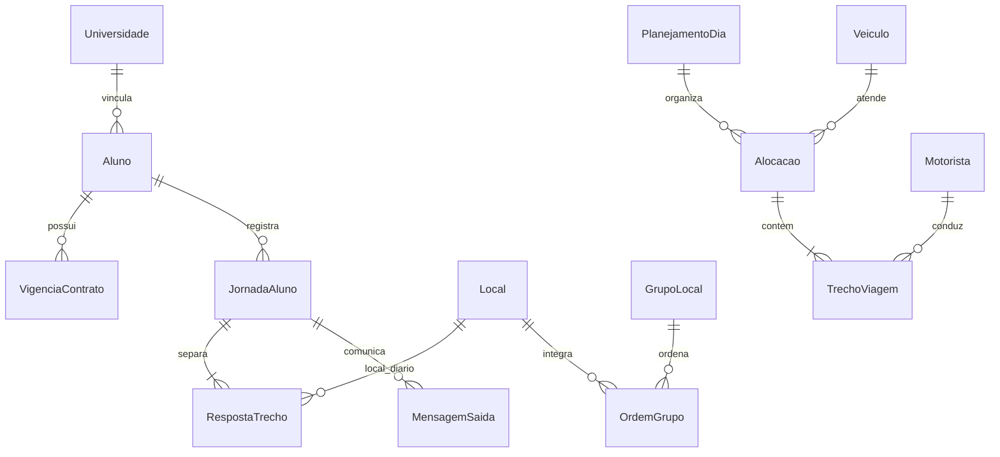

# Modelo de dados — proposta conceitual

[Início](../README.md) · [Arquitetura](arquitetura.md) · [Dados](modelo-dados.md) · [API](api.md) · [Backlog](backlog.md) · [Regras](requisitos.md)

Entidades e restrições para orientar o backend. B03 implementa somente a tabela mínima de equipe e sua migração, conforme [dados B03](../specs/002-autorizacao-equipe/data-model.md); B04 implementa catálogo fixo de universidades, alunos e vigências conforme [dados B04](../specs/003-cadastros-vigencias/data-model.md); B05 implementa calendário semanal e exceções conforme [dados B05](../specs/004-calendarios-elegibilidade/data-model.md); B06 implementa grupos, regiões, pontos, locais de retorno validados e padrões por trecho conforme [dados B06](../specs/005-grupos-locais/data-model.md); demais entidades seguem propostas. TypeORM e migrações versionadas com `synchronize: false` estão escolhidos; modelagem física dos próximos módulos segue pendente. IDs técnicos, datas de criação/alteração e versão de concorrência são propostos. Não incluir financeiro, presença física ou histórico público.

## Entidades

| Entidade | Campos essenciais propostos | Relações/restrições |
| --- | --- | --- |
| UsuarioEquipe | identidade de login, perfil admin/operador/motorista, ativo | Convites e perfis só admin; perfil único/fixo, sem personalização, preservando último admin ativo; identidade vinculada ao Supabase Auth; e-mail individual, status e permissões operacionais validados no NestJS. Não armazenar senha do usuário neste cadastro. |
| Motorista | nome, vínculo opcional com UsuarioEquipe | Ligação ao usuário necessária para liberar suas viagens; não inferir acesso pelo nome. |
| Universidade | nome, dias de operação habituais | Unimater/Unidep no recorte; 1:N alunos e exceções. |
| ExcecaoCalendario | universidade, data, opera, motivo | Uma exceção por universidade/data, prevalece sobre semana habitual. |
| Aluno | nome, telefone normalizado, universidade, dias habituais, ponto padrão ida, local padrão volta, ativo | Telefone identifica univocamente aluno no contexto da empresa; duplicidade exige resolução cadastral, sem adivinhar identidade. |
| VigenciaContrato | aluno, início, fim | Início ≤ fim; nenhum valor/pagamento. Regra confirmada: vigência cobre as datas inicial e final; rejeitar datas invertidas e sobreposição de intervalos para o mesmo aluno. |
| Rota | nome, período noturno, origem comum, fiscalização | Única rota conceitual do recorte; origem pode estar pendente de cadastro, não inventar endereço. |
| RegiaoAtendida | nome, definição territorial a determinar | Empresa define área; geometria/provedor não escolhidos. |
| GrupoLocal | rota, sentido coleta/distribuição, nome | Definido manualmente, distinto por sentido. |
| Vínculos locais B06 | região → grupo de distribuição; ponto → grupo de coleta | Um grupo por região/ponto, vários pontos/regiões por grupo; campos diretos com restrição de sentido, sem tabela de associação múltipla. |
| Local | endereço/referência canônicos, região, evidência/status da validação, identificador opcional externo | Não exigir coordenadas antes de escolher método. Endereço inválido/indeterminado não substitui válido. |
| PontoEmbarque | rota, local, referência, ativo | Apenas registros pré-cadastrados são elegíveis para ida. |
| OrdemGrupo | grupo, local, posição | Unicidade grupo/local e grupo/posição; local novo sem posição é pendência explícita, nunca inserido por algoritmo inventado. |
| JornadaAluno | aluno, data operacional, universidade do dia, origem habitual/extra, versão | Única por aluno/data; preserva contexto diário mesmo se cadastro mudar depois. |
| RespostaTrecho | jornada, sentido ida/volta, estado, origem, local do dia, instante/versão da última informação válida, referência do comando | Única por jornada/sentido; estado e origem separados. Local do dia não altera padrão. |
| ComandoRecebido | identificador externo/idempotência, ator/origem, recebido em, intenção validada, resultado, jornada, versão | Registro mínimo para deduplicação/ordenação; texto bruto e retenção dependem de política, não salvar conteúdo ilimitado por padrão. |
| SugestaoPadrao | aluno, sentido, local alternativo, sequência de referência, estado proposta/aceita/recusada, consentimento | Única por sequência; aceite explícito. Contribuições usam jornadas confirmadas, não embarque real. |
| Veiculo | número/identificação frota, placa, tipo van/micro/ônibus, assentos passageiros, ativo | Placa/identificação únicas no cadastro; assentos inteiro positivo. |
| DisponibilidadeVeiculo | veículo, data/intervalo ou etapa, disponível | Representação de intervalos/etapas a fechar; precisa distinguir simultaneidade e reuso posterior. |
| PlanejamentoDia | data, versão de demanda, status rascunho/ajuste necessário/confirmado, confirmador | Não confirmar com demanda desatualizada, conflito ou excesso de assentos. |
| Alocacao | planejamento, tipo local/intermunicipal, universidade ou grupo, veículo, janela de ocupação, estado operacional | Intermunicipal vincula o mesmo veículo a ida/permanência/retorno; local é manual. Uma alocação confirmada não sobrepõe uso simultâneo do veículo. |
| TrechoViagem | alocação, etapa, início/fim planejados, motorista | Atribuição por veículo/trecho; motorista pode variar por trecho sem trocar veículo intermunicipal. |
| MensagemSaida | jornada/destinatário, tipo/slot, conteúdo aprovado ou referência, estado, chave de efeito | Separa comunicação de confirmação. Correção manual não cria mensagem automática. |
| TentativaEnvio | mensagem, número tentativa, identificador provedor, estado/erro | Callback e reenvio não alteram RespostaTrecho. |
| PendenciaOperacional | tipo, entidade referida, estado, detalhe mínimo | Incompreensão, falha, endereço sem ordem, conflito; não representa aprovação tardia do aluno. |

Contagens e opções de veículos são projeções calculadas, não verdades duplicadas em tabelas independentes. Podem ser registradas como fotografia versionada do planejamento, sempre revalidadas na confirmação.

## Estados por trecho

| Estado | Significado | Entra na capacidade? |
| --- | --- | --- |
| sem_resposta | Nenhuma informação válida desse sentido | Não |
| indeciso | Dúvida expressa | Não, exceto quando volta vira confirmado pelo fechamento com ida confirmada |
| confirmado | Intenção efetiva, inclusive volta derivada conforme regra | Sim |
| recusado | Recusa explícita | Não |
| cancelado | Volta antes confirmada, cancelada | Não |

Origens propostas: aluno_explicito, implicito_da_ida, padrao_fechamento, equipe. Guardar indicação de recusa explícita no estado/contexto para impedir que fechamento a reverta. “Vou só na ida” gera ida confirmada e volta recusada; “vou só na volta” gera ida recusada e volta confirmada. Uma mensagem incompreendida não substitui estados válidos.

Ao declarar ida e dúvida da volta, volta fica indecisa até 17h; fechamento a confirma com origem padrao_fechamento. Para quem não respondeu nada, nenhum registro vira confirmado. Última revisão explícita válida até o corte pode substituir a anterior. Cancelamento e fechamento repetidos devem ser idempotentes.

## Restrições transacionais essenciais

- Capacidade intermunicipal = maior contagem de confirmados ida/volta por universidade. Um aluno conta uma vez em cada sentido, independentemente de mensagens repetidas. Mesma capacidade de veículos gera opções equivalentes.
- Seleção/confirmacão de planejamento deve bloquear concorrência sobre alocações relevantes e revalidar versão da demanda. Não basta verificar conflito antes da transação.
- Janela intermunicipal ocupa ida, permanência e retorno; coleta/distribuição em períodos posteriores não conflitam automaticamente. Um veículo não atende dois grupos na mesma etapa de distribuição.
- Correção da equipe grava resposta e invalida planejamento quando necessário na mesma transação. Excesso exige ajuste antes de confirmar, sem mensagem automática ao aluno.
- Atualização de local: validar área/grupo antes da troca; preservar válido anterior em falha. Mudança de padrão grava consentimento/pedido e novo padrão conjuntamente.
- Sequência por aluno/sentido deriva de datas com trecho confirmado e local final válido, desconsiderando cancelamentos. Uma data não contribui duas vezes; outro local reinicia, dias sem viagem não. Canonicalização de locais precisa evitar contar grafias equivalentes como lugares diferentes.

## Relações principais

Diagrama parcial: não substitui as restrições da tabela. Desativação B06 preserva referências e impede novas utilizações com ajuste manual; retenção e granularidade temporal de módulos futuros continuam pendentes; não presumir apagar dados ao fechar dia. Não expor esses registros como histórico operacional no MVP.
