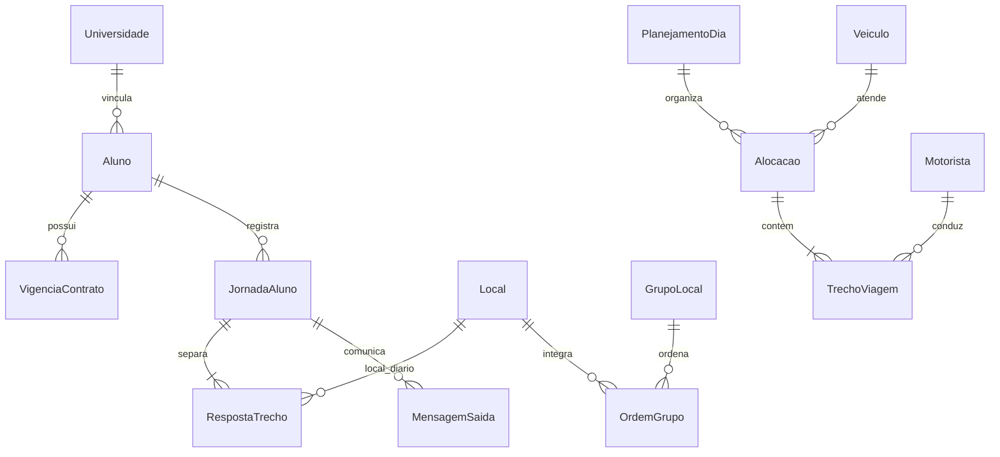

# Modelo de dados — proposta conceitual

> **Consolidação para apresentação — 17/11/2026:** consulte o [guia completo](guia-apresentacao-andamento.md) e o [inventário técnico](inventario-tecnico-andamento.md). Backend e painel locais, contexto de conversa, agendador, pontos fixos, disponibilidade diária e prévia Google Maps estão implementados. Ensaio WhatsApp de 09/11 foi parcial; cadeia completa, hospedagem e avaliação acadêmica permanecem pendentes. Ordem de paradas continua manual; quarta utilização está fora da entrega. Trechos antigos abaixo que divergem desse estado são históricos; as evidências de cada incremento delimitam o que foi validado.

11/11/2026 — Endereços dos pontos: cadastro próprio estruturado (logradouro/localização, número textual ou sem número, bairro, cidade, UF, Brasil, CEP e complemento) e referência da parada separada, exibida no itinerário/motorista. Bairro, CEP e complemento opcionais. Texto antigo preservado, detalhamento somente explícito; UUIDs, grupos, padrões e ordem manual mantidos. Validação estrutural não comprova endereço real. Maps/geocodificação/rotas continuam futuros. Implementação: specs/025-enderecos-pontos/.

boarding_points e return_locations recebem address_details (JSONB validado), stop_reference (texto até 1000), legacy_address (cópia preservada). address é formatado pelo backend para compatibilidade. Migração aditiva 1794900000000, sem alteração de identidade/provider/external_key.

## Modelo vigente por dia — 11/11/2026

`fleet_vehicles.day_week` contém sete booleanos (domingo a sábado), ou null sem configuração. `fleet_exceptions.available` contém sim/não, ou null para herdar a semana. `week` e `windows` antigos permanecem preservados, fora da avaliação nova. Não presumir disponibilidade integral a partir de faixa parcial. Reservas novas em `operation_occupancies` usam data, etapa e trecho; índices únicos parciais impedem duplicar veículo na etapa ou motorista no trecho. Horários antigos permanecem nos registros legados; novos registros não têm início/fim. Migrações aditivas `1794800000000` e `1794800000001`; planos confirmados antigos sinalizam revisão.

B18.4: migração `1794700000000-conversation-context.ts` acrescenta `whatsapp_events.reply_to`, `conversation_clarifications` e `message_interpretations.context_event_id`. Pergunta, reserva, resultado e consumo persistentes; unicidade por origem e cadeia ativa por aluno/dia, identificador do provedor por instância. Aplicação tem SELECT/INSERT/UPDATE, sem DELETE. [Modelo físico e estados](../specs/020-contexto-conversa/data-model.md).

Pontos fixos (04/11): migra??o1794600000000 estende return_locations com nome, endere?o descritivo, grupo direto de distribui??o, ativo e vers?o. Registros legados preservam regi?o; constraint separa as duas formas sem convers?o autom?tica. IDs de padr?es/jornadas/itiner?rios permanecem. Atualiza??o autorizada ao papel app, sem DELETE/DDL.

## Persistência B18.3

Complemento: conversation_jobs registra a reserva de processamento; journey_acknowledgements guarda o recibo transacional e a tentativa de despacho. Migrações1794400000000/1794500000000 preservam evidências de processamento/envio. [Estados e limites](../specs/019-interpretacao-mensagens/automation.md).

`message_interpretations` tem chave/FK event_id para whatsapp_events, estado processing/completed, origem, versão técnica, proposta JSON restrita, código e instantes. Uma tentativa por evento; sem segredo/envelope bruto. Aplicação sem DELETE/DDL, reversão protegida; migração1794200000000 aditiva em dev/test. Recibo, jornada, aluno e primeiro horário não são reescritos. [Dados](../specs/019-interpretacao-mensagens/data-model.md).

B18.1 (28/10/2026): migração aditiva OwnAuth1794000000000 acrescenta auth_credentials, auth_sessions, auth_events e auth_attempt_windows, preservando team_users.id/subject e vínculos. E-mail normalizado único, senhas/tokens sem persistência em claro, estados de troca/revogação, aplicação sem DDL/DELETE e eventos sem UPDATE. [Modelo efetivo](../specs/017-autenticacao-propria/data-model.md). Substitui a pendência de modelagem de autenticação abaixo; nenhuma conta padrão ou credencial real criada.

[Início](../README.md) · [Arquitetura](arquitetura.md) · [Dados](modelo-dados.md) · [API](api.md) · [Backlog](backlog.md) · [Regras](requisitos.md)

Entidades e restrições para orientar o backend. B03 implementa somente a tabela mínima de equipe e sua migração, conforme [dados B03](../specs/002-autorizacao-equipe/data-model.md); B04 implementa catálogo fixo de universidades, alunos e vigências conforme [dados B04](../specs/003-cadastros-vigencias/data-model.md); B05 implementa calendário semanal e exceções conforme [dados B05](../specs/004-calendarios-elegibilidade/data-model.md); B06 implementa grupos, regiões, pontos, locais de retorno validados e padrões por trecho conforme [dados B06](../specs/005-grupos-locais/data-model.md); B07 implementa jornada diária única e recebimentos duráveis conforme [dados B07](../specs/006-jornada-comandos/data-model.md); B08 amplia jornada/recibos com marcas de fechamento, origem padrão e cancelamento conforme [dados B08](../specs/007-fechamento-cancelamento/data-model.md); demais entidades seguem propostas. TypeORM e migrações versionadas com `synchronize: false` estão escolhidos; modelagem física dos próximos módulos segue pendente. IDs técnicos, datas de criação/alteração e versão de concorrência são propostos. Não incluir financeiro, presença física ou histórico público.

## Entidades

| Entidade | Campos essenciais propostos | Relações/restrições |
| --- | --- | --- |
| UsuarioEquipe | identidade de login, perfil admin/operador/motorista, ativo | Criação de contas, recuperação e perfis só admin; perfil único/fixo, sem personalização, preservando último admin ativo; autenticação própria no NestJS aprovada em B18, com identificação individual, status e permissões validados no backend. Persistência de credenciais e sessões será desenhada na especificação B18; nenhuma mudança física implementada. |
| Motorista | nome, vínculo opcional com UsuarioEquipe | Ligação ao usuário necessária para liberar suas viagens; não inferir acesso pelo nome. |
| Universidade | nome, dias de operação habituais | Unimater/Unidep no recorte; 1:N alunos e exceções. |
| ExcecaoCalendario | universidade, data, opera, motivo | Uma exceção por universidade/data, prevalece sobre semana habitual. |
| Aluno | nome, telefone normalizado, universidade, dias habituais, ponto padrão ida, local padrão volta, ativo | Telefone identifica univocamente aluno no contexto da empresa; duplicidade exige resolução cadastral, sem adivinhar identidade. |
| VigenciaContrato | aluno, início, fim | Início ≤ fim; nenhum valor/pagamento. Regra confirmada: vigência cobre as datas inicial e final; rejeitar datas invertidas e sobreposição de intervalos para o mesmo aluno. |
| Rota | nome, período noturno, origem comum, fiscalização | Única rota conceitual do recorte; origem pode estar pendente de cadastro, não inventar endereço. |
| RegiaoAtendida | nome, definição territorial a determinar | Empresa define área; geometria/provedor não escolhidos. |
| GrupoLocal | rota, sentido coleta/distribuição, nome | Definido manualmente, distinto por sentido. |
| Vínculos locais B06 | região → grupo de distribuição; ponto → grupo de coleta | Um grupo por região/ponto, vários pontos/regiões por grupo; campos diretos com restrição de sentido, sem tabela de associação múltipla. |
| Local | endereço/referência canônicos, região, evidência/status da validação, identificador opcional externo | Não exigir coordenadas antes de escolher método. Endereço inválido/indeterminado não substitui válido. |
| PontoEmbarque | rota, local, referência, ativo | Apenas registros pré-cadastrados são elegíveis para ida. |
| OrdemGrupo | grupo, local, posição | Unicidade grupo/local e grupo/posição; local novo sem posição é pendência explícita, nunca inserido por algoritmo inventado. |
| JornadaAluno | aluno, data operacional, universidade do dia, origem habitual/extra, versão | Única por aluno/data; preserva contexto diário mesmo se cadastro mudar depois. |
| RespostaTrecho | jornada, sentido ida/volta, estado, origem, local do dia, instante/versão da última informação válida, referência do comando | Única por jornada/sentido; estado e origem separados. Local do dia não altera padrão. |
| ComandoRecebido | identificador externo/idempotência, ator/origem, recebido em, intenção validada, resultado, jornada, versão | Registro mínimo para deduplicação/ordenação; texto bruto e retenção dependem de política, não salvar conteúdo ilimitado por padrão. |
| SugestaoPadrao | aluno, sentido, local alternativo, sequência de referência, estado proposta/aceita/recusada, consentimento | Única por sequência; aceite explícito. Contribuições usam jornadas confirmadas, não embarque real. |
| Veiculo | número/identificação frota, placa, tipo van/micro/ônibus, assentos passageiros, ativo | Placa/identificação únicas no cadastro; assentos inteiro positivo. |
| DisponibilidadeVeiculo | veículo, semana/exceção por data, disponível | Sim/não por dia; sem horários. |
| PlanejamentoDia | data, versão de demanda, status rascunho/ajuste necessário/confirmado, confirmador | Não confirmar com demanda desatualizada, conflito ou excesso de assentos. |
| Alocacao | planejamento, tipo local/intermunicipal, universidade ou grupo, veículo, data e etapa, estado operacional | Intermunicipal vincula o mesmo veículo a ida/permanência/retorno; local é manual. Veículo não atende dois grupos/universidades na mesma etapa e dia; reuso entre etapas permitido. |
| TrechoViagem | alocação, etapa, sentido, motorista | Atribuição por veículo/trecho; motorista pode variar por trecho sem trocar veículo intermunicipal. |
| MensagemSaida | jornada/destinatário, tipo/slot, conteúdo aprovado ou referência, estado, chave de efeito | Separa comunicação de confirmação. Correção manual não cria mensagem automática. |
| TentativaEnvio | mensagem, número tentativa, identificador provedor, estado/erro | Callback e reenvio não alteram RespostaTrecho. |
| PendenciaOperacional | tipo, entidade referida, estado, detalhe mínimo | Incompreensão, falha, endereço sem ordem, conflito; não representa aprovação tardia do aluno. |

Contagens e opções de veículos são projeções calculadas, não verdades duplicadas em tabelas independentes. Podem ser registradas como fotografia versionada do planejamento, sempre revalidadas na confirmação.

## Estados por trecho

| Estado | Significado | Entra na capacidade? |
| --- | --- | --- |
| sem_resposta | Nenhuma informação válida desse sentido | Não |
| indeciso | Dúvida expressa | Não, exceto quando volta vira confirmado pelo fechamento com ida confirmada |
| confirmado | Intenção efetiva, inclusive volta derivada conforme regra | Sim |
| recusado | Recusa explícita | Não |
| cancelado | Volta antes confirmada, cancelada | Não |

Origens propostas: aluno_explicito, implicito_da_ida, padrao_fechamento, equipe. Guardar indicação de recusa explícita no estado/contexto para impedir que fechamento a reverta. “Vou só na ida” gera ida confirmada e volta recusada; “vou só na volta” gera ida recusada e volta confirmada. Uma mensagem incompreendida não substitui estados válidos.

Ao declarar ida e dúvida da volta, volta fica indecisa até 17h; fechamento a confirma com origem padrao_fechamento. Para quem não respondeu nada, nenhum registro vira confirmado. Última revisão explícita válida até o corte pode substituir a anterior. Cancelamento e fechamento repetidos devem ser idempotentes.

## Restrições transacionais essenciais

- Capacidade intermunicipal = maior contagem de confirmados ida/volta por universidade. Um aluno conta uma vez em cada sentido, independentemente de mensagens repetidas. Mesma capacidade de veículos gera opções equivalentes.
- Seleção/confirmacão de planejamento deve bloquear concorrência sobre alocações relevantes e revalidar versão da demanda. Não basta verificar conflito antes da transação.
- Janela intermunicipal ocupa ida, permanência e retorno; coleta/distribuição em períodos posteriores não conflitam automaticamente. Um veículo não atende dois grupos na mesma etapa de distribuição.
- Correção da equipe grava resposta e invalida planejamento quando necessário na mesma transação. Excesso exige ajuste antes de confirmar, sem mensagem automática ao aluno.
- Atualização de local: validar área/grupo antes da troca; preservar válido anterior em falha. Mudança de padrão grava consentimento/pedido e novo padrão conjuntamente.
- Sequência por aluno/sentido deriva de datas com trecho confirmado e local final válido, desconsiderando cancelamentos. Uma data não contribui duas vezes; outro local reinicia, dias sem viagem não. Canonicalização de locais precisa evitar contar grafias equivalentes como lugares diferentes.

## Relações principais

Diagrama parcial: não substitui as restrições da tabela. Desativação B06 preserva referências e impede novas utilizações com ajuste manual; retenção e granularidade temporal de módulos futuros continuam pendentes; não presumir apagar dados ao fechar dia. Não expor esses registros como histórico operacional no MVP.

## Implementação B10
Sequências são derivadas das jornadas existentes; nenhuma tabela duplicada de contribuições. Decisões sobre padrões/sugestões ficam em place_pattern_decisions, ligadas ao recibo e ao local, com evidência atômica no padrão. Aplicação pode consultar/inserir decisões, sem editar/apagar. [Modelo físico B10](../specs/009-padroes-sequencia/data-model.md). Sem histórico público ou retenção automática.

## Implementação B11
Registro histórico B11: frota, motoristas e exceções em três tabelas. Semana/faixas substituídas pelo modelo diário acima; revisão compartilhada do veículo e aplicação sem DELETE/DDL preservadas. Etapas são avaliadas como propostas, sem alocação persistida nesta etapa. [Modelo físico B11](../specs/010-frota-disponibilidade/data-model.md).

## Implementação B12
Planos separam rascunho e fotografia confirmada; ocupações de veículo/motorista usam timestamps absolutos para detectar conflitos entre datas. Substituição desativa ocupações antigas somente na confirmação válida; falha reverte a transação. Triggers de jornada/recibo marcam revisão necessária sem excluir registros. [Modelo físico B12](../specs/011-alocacao-planejamento/data-model.md). Sem DELETE/DDL para a aplicação e sem retenção automática.

## Implementação B13
Origem equipe nos trechos corrigidos e registro imutável em team_corrections, associado a recibo interno finalizado que ordena a correção. Recibos revisados recebem resolução explícita; não são apagados. Aplicação não pode editar/apagar o registro. [Modelo físico B13](../specs/012-correcoes-equipe/data-model.md). Jornada, pendências e invalidação do planejamento são gravadas atomicamente.

## Implementação B16
group_stop_orders guarda revisão e sequência de IDs canônicos por grupo. published_itineraries guarda última publicação explícita por data/grupo, versão do plano/ordem, responsável, instante e token da prévia. Arrays sem nulos/duplicados; validade e pertencimento verificados sob lock de locais. Aplicação sem DELETE/DDL e reversão protegida contra perda de evidências. [Modelo físico B16](../specs/015-trajeto-contingencia/data-model.md).

## Implementação B15
driver_access_links mantém associação exclusiva conta/motorista e revisão, preservando a linha ao revogar. operation_manifests registra vínculos aluno/sentido/universidade/grupo por versão confirmada, sem edição pela aplicação. Plano anterior sem manifesto exige reconfirmação antes de publicar passageiros; não há preenchimento retroativo presumido. Reversão recusa dados existentes. [Modelo físico B15](../specs/014-consultas-operacionais/data-model.md).

## Implementação B18.2

`whatsapp_events` guarda projeção limitada, identidade externa única, primeiro recebimento e conflito; FK composta associa aluno/recibo B07. `whatsapp_attempts` referencia tentativa/mensagem B14 e ID comprovado do fornecedor. Sem envelope bruto, DELETE/DDL pela aplicação ou retenção automática; reversão bloqueada com dados. Migração1794100000000 aplicada em dev/test. Banco Evolution totalmente separado. [Modelo físico](../specs/018-whatsapp-local/data-model.md).

## Implementação B14
outgoing_messages e message_attempts separam comunicação de confirmação de viagem; chave aluno/data/slot e reserva transacional evitam duplicação concorrente. Jornada guarda início elegível do pedido extra e seu instante. Aplicação sem DELETE/DDL, reversão bloqueada com evidências; nenhuma retenção automática. [Modelo físico B14](../specs/013-mensagens-agendamentos/data-model.md).
